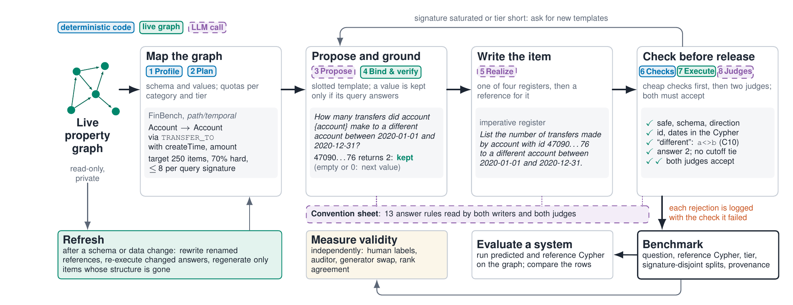

# PIPE-Cypher

PIPE-Cypher is a synthetic data pipeline that creates balanced, executable, privacy-aware NL-to-Cypher benchmarks for enterprise knowledge graphs. The value here is that enterprise graphs are highly differentiated: their schemas, terminology, query patterns, and even the questions users ask are unique to each deployment. A strong coding agent today can probably generate data by inspecting a schema, but PIPE-Cypher makes this scalable, cost-effective, and repeatable when the schema inevitably changes. By constraining this as a pipeline, even small local models can efficiently create large amounts of synthetic benchmark data, with deterministic graph checks for balance, diversity, auditability, and execution validity. That makes it useful for keeping private Text2Cypher benchmarks grounded in how a graph is actually used as it evolves.

## How it works



An LLM proposes question templates, and each template is filled only with
values for which its own query returns an answer on the live graph (reverse
querying). Deterministic checks reject unsafe or inconsistent items, and a
cross-family judge panel reads what remains against a written convention
sheet. The same machinery refreshes a benchmark after a schema change, and the
validity of what is generated is measured separately with human labels, an
outside auditor, and curated benchmarks.

## Contents

| Path | What it holds |
|---|---|
| `pipecypher/` | The pipeline: profiling, planning, template binding, checks, judges, export, scoring, refresh |
| `scripts/` | Command-line entry points for building, evaluating, auditing, and analysis |
| `configs/` | Build configurations (`finbench_v3.yaml`, `snb_v3.yaml`, public-graph and ablation configs), schemas, difficulty model |
| `tests/` | Deterministic unit tests (no GPU, no graph, no network) |
| `release/benchmarks/` | The released benchmarks: FinBench/SNB (3,038 items, signature-disjoint train/dev/test) and the three public-graph builds |
| `release/predictions/` | Zero-shot predictions of the 11 evaluated models on all 3,038 items, with score summaries |
| `release/results/` | The result files behind the paper's tables and figures |
| `release/human_validation/` | The 70 audited items, sampling key and weights, and the annotators' labels (annotators appear as A and B) |
| `docs/` | Benchmark row format and onboarding guide for a new graph |

## Quick start

```bash
python -m venv .venv && . .venv/bin/activate
pip install -e ".[dev]"
python -m pytest -q          # deterministic tests
python scripts/run_pipeline.py --config configs/finbench_v3.yaml --offline-smoke   # no graph or model needed
```

## Reproducing the paper

See `REPRODUCIBILITY.md` for the full sequence. In short:

1. Load the public graphs into Neo4j 5 (`scripts/load_finbench_neo4j.sh`,
   `scripts/load_snb_neo4j.sh`, `scripts/fetch_neo4j_example_graphs.sh`).
2. Point a config at the graph and at any OpenAI-compatible endpoint serving
   the generator and judges, then build: `scripts/launch_cells.sh` runs one
   process per category, seed, and graph; `scripts/export_benchmark.py`
   writes the splits.
3. Generate and score predictions with
   `scripts/generate_text2cypher_predictions.py` and
   `scripts/evaluate_benchmark_predictions.py`.
4. Recompute the analyses from the released predictions and labels (no model
   calls): `scripts/reference_quality_sensitivity.py`,
   `scripts/order_aware_rescoring.py`, `scripts/query_metric_comparison.py`,
   `scripts/corrected_reference_rescoring.py`.

Every script documents its options under `--help`. API keys are read from the
environment and are never written to configs, logs, or outputs.

## Models and data

All graphs are public (LDBC FinBench, LDBC SNB, and the Neo4j example graphs
Recommendations, Northwind, and FinCEN). The generator and both judges have
open weights; a closed model is used only as outside auditor, replay
generator, and downstream reference, and never decides what is released.

## Citation

See `CITATION.cff`. A paper describing this version is under review.

## License

MIT (see `LICENSE`). The benchmark items derive from public LDBC and Neo4j
example data and are released for research use.
